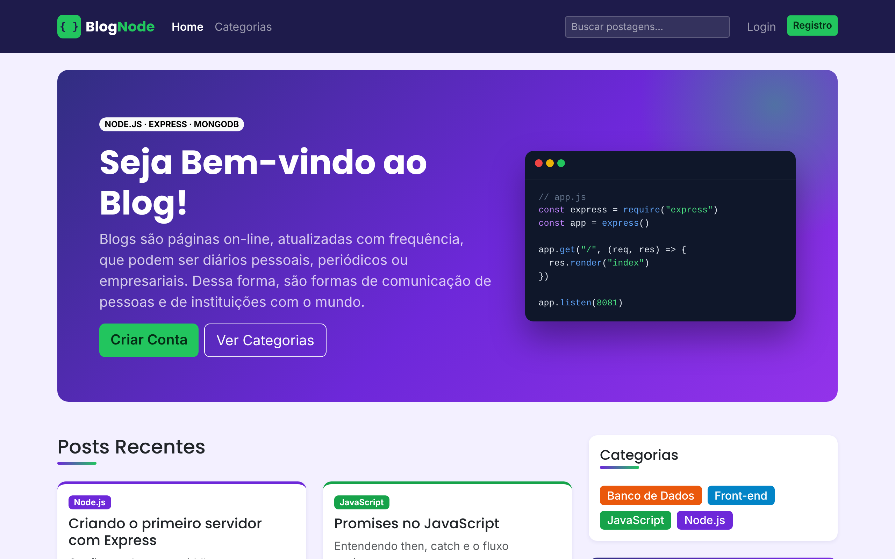
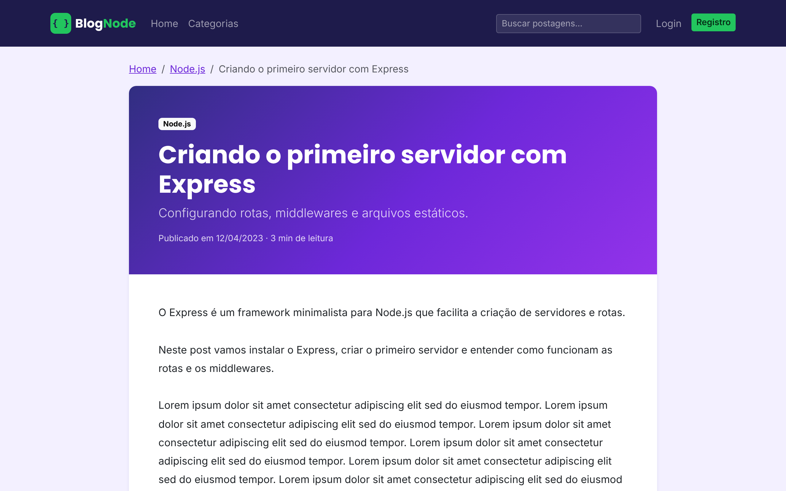
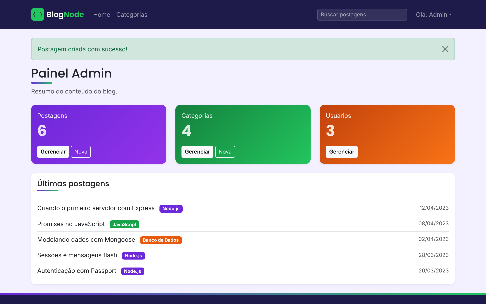
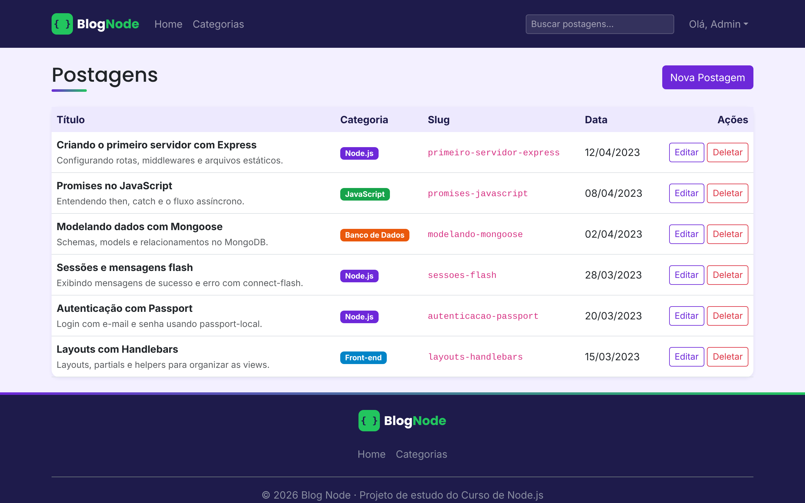

# ProjetoBlog

Blog with an admin panel, built as the final project of the **Node.js Course** by instructor **Victor Lima** (Guia do Programador).

The application lets administrators create categories and posts through a restricted area, and also supports user registration, login and logout.

## Technologies

| Technology | Purpose |
| --- | --- |
| [Node.js](https://nodejs.org) | Runtime |
| [Express](https://expressjs.com) | Server and routes |
| [Express Handlebars](https://github.com/express-handlebars/express-handlebars) | View template engine |
| [MongoDB](https://www.mongodb.com) + [Mongoose](https://mongoosejs.com) | Database and models |
| [Passport](https://www.passportjs.org) + passport-local | Authentication |
| [bcryptjs](https://github.com/dcodeIO/bcrypt.js) | Password hashing |
| express-session + connect-flash | Sessions and feedback messages |
| [Bootstrap 5](https://getbootstrap.com) | Styling |
| [Poppins](https://fonts.google.com/specimen/Poppins) (Google Fonts) | Heading font |

## Features

**Public area**
- Home page with the latest posts and a categories sidebar
- Search posts by title or description
- Individual post page (accessed by slug) with reading time and related posts from the same category
- Category list with the number of posts in each
- User registration, login and logout, with a user menu in the navbar
- 404 page for non-existent routes
- Responsive layout (works on mobile)

**Admin area** (`/admin`, admin users only)
- Dashboard with total posts, categories and users, plus the latest posts
- Category CRUD
- Post CRUD
- Slug automatically generated from the title/name
- Confirmation before deleting
- Listing, editing and deleting users *(extra, beyond the course)*

## Screenshots

| Home | Post |
| --- | --- |
|  |  |

| Admin panel | Admin panel: posts |
| --- | --- |
|  |  |

> The screenshots use sample data.

## Folder structure

```
ProjetoBlog/
├── app.js              # Main file: settings, public routes and server
├── config/
│   └── auth.js         # Passport login strategy
├── helpers/
│   ├── eAdmin.js       # Middleware that restricts routes to administrators
│   └── handlebars.js   # Helpers used in the views (date, reading time...)
├── models/
│   ├── Categoria.js
│   ├── Postagem.js
│   └── Usuario.js
├── routes/
│   ├── admin.js        # /admin routes (categories, posts and users)
│   └── usuario.js      # /usuarios routes (registration, login and logout)
├── docs/screenshots/   # Images used in this README
├── public/             # Static files (Bootstrap, css/style.css and js/main.js)
└── views/              # Handlebars templates
    ├── layouts/        # Main layout (main)
    ├── partials/       # Navbar, footer and messages
    ├── admin/
    ├── categorias/
    ├── postagem/
    └── usuarios/
```

## Routes

| Method | Route | Description |
| --- | --- | --- |
| GET | `/` | Home page with posts |
| GET | `/busca?q=termo` | Post search |
| GET | `/postagem/:slug` | Post page |
| GET | `/categorias` | Category list |
| GET | `/categorias/:slug` | Posts in a category |
| GET/POST | `/usuarios/registro` | User registration |
| GET/POST | `/usuarios/login` | Login |
| GET | `/usuarios/logout` | Logout |
| GET | `/admin` | Admin panel |
| GET | `/admin/categorias` | Category list |
| GET | `/admin/categorias/add` | New category form |
| POST | `/admin/categorias/new` | Creates category |
| GET | `/admin/categorias/edit/:id` | Edit form |
| POST | `/admin/categorias/edit` | Saves changes |
| POST | `/admin/categorias/delete` | Deletes category |
| GET | `/admin/postagens` | Post list |
| GET | `/admin/postagens/add` | New post form |
| POST | `/admin/postagens/new` | Creates post |
| GET | `/admin/postagens/edit/:id` | Edit form |
| POST | `/admin/postagens/edit` | Saves changes |
| GET | `/admin/postagens/delete/:id` | Deletes post |
| GET | `/admin/usuarios` | User list |
| GET | `/admin/usuarios/edit/:id` | Edit form |
| POST | `/admin/usuarios/edit` | Saves changes |
| POST | `/admin/usuarios/delete` | Deletes user |

## How to run

### Prerequisites
- [Node.js](https://nodejs.org) installed
- [MongoDB](https://www.mongodb.com/try/download/community) running locally on the default port (`27017`)

### Steps

1. Go to the project folder and install the dependencies:

```bash
cd ProjetoBlog
```

```bash
npm install
```

2. Start the server:

```bash
npm start
```

3. Open <http://localhost:8081>.

The `blogapp` database is created automatically by MongoDB on the first write.

### Creating an administrator

Every user is created as a regular user (`eAdmin: 0`). To grant access to the `/admin` panel, register a user through the site and change the field in MongoDB:

```bash
mongosh blogapp --eval 'db.usuarios.updateOne({email: "your@email.com"}, {$set: {eAdmin: 1}})'
```

Then log out and log in again.

## Credits

Project built following the [Node.js Course](https://www.youtube.com/playlist?list=PLJ_KhUnlXUPtbtLwaxxUxHqvcNQndmI4B) by instructor Victor Lima.
