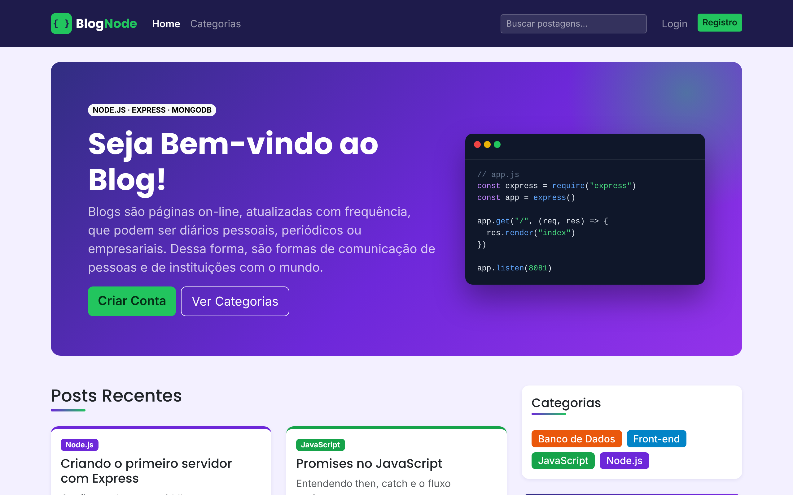

# Curso de Node.js

Repositório com os exercícios e projetos desenvolvidos durante o [Curso de Node.js](https://www.youtube.com/playlist?list=PLJ_KhUnlXUPtbtLwaxxUxHqvcNQndmI4B) do professor **Victor Lima** (Guia do Programador).

O curso aborda Node.js, Express, Handlebars, MySQL com Sequelize e MongoDB com Mongoose. Cada aula foi registrada em um commit (`Aula: <tema>`), e o histórico pode ser usado como roteiro de estudo.

## Conteúdo

| Pasta | Tema | Tecnologias |
| --- | --- | --- |
| [`HelloWorld`](./HelloWorld) | Primeiro código e módulos | Node.js |
| [`Test`](./Test) | Módulos (`require` / `module.exports`) | Node.js |
| [`Test2`](./Test2) | Servidor HTTP nativo | Node.js (`http`) |
| [`Test3`](./Test3) | Rotas, parâmetros e exibição de HTML | Express |
| [`TestSql`](./TestSql) | Criação e manipulação de tabelas | MySQL |
| [`TestSequelize`](./TestSequelize) | Conexão e models | Sequelize, MySQL |
| [`Projeto1`](./Projeto1) | Cadastro, listagem e exclusão de posts | Express, Handlebars, Sequelize, MySQL |
| [`TestMongoose`](./TestMongoose) | Primeiros passos com MongoDB | Mongoose |
| [`ProjetoBlog`](./ProjetoBlog) | **Projeto final**: blog com painel admin e autenticação | Express, Handlebars, Mongoose, Passport |

### Projeto final: ProjetoBlog



Veja o [README do ProjetoBlog](./ProjetoBlog/README.md) para detalhes do projeto final.

## Tecnologias utilizadas

**Back-end**

   

**Banco de dados**

   

**Front-end**

    

**Ferramentas**

  

**Outras bibliotecas:** body-parser (dados dos formulários), express-session e connect-flash (sessões e mensagens de feedback) e bcryptjs (hash de senhas).

## Como executar um projeto

Cada pasta é independente. As dependências não ficam no repositório, então instale-as antes de rodar:

```bash
cd NomeDaPasta
```

```bash
npm install
```

```bash
node app.js
```

O arquivo principal varia por pasta (`app.js`, `index.js`, `teste.js`, `mongoose.js`). Os projetos com banco de dados precisam do MySQL ou do MongoDB rodando localmente.
